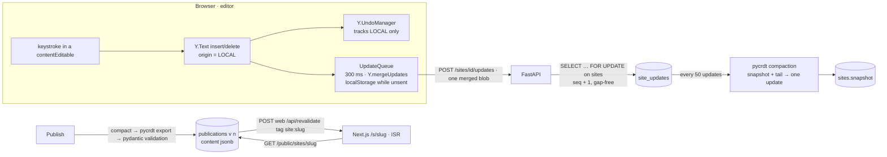

# Pagecraft

**Build it together.** A one-page website builder: pick a template, edit every section right on the page, publish to its own address. Built on a CRDT document from day one, so two people editing at once (v2) is an addition, not a rewrite.

> Status: **v1 · Solo studio built** (2026-11-26) — auth + demo logins, dashboard, six templates, the section editor (inline text, layers, inspector, theme, uploads, undo/redo, autosave), publish with ISR, settings. [Tracker](https://claude.ai/artifact/AxW5iwEzxWmtSdLdfnjQfB) · [Screens](https://claude.ai/artifact/UKnMgDx9dvkEmFUrxWSLjS). One of six portfolio projects by [Viraj Domadia](https://virajdomadia.com). **Live:** https://pagecraft.virajdomadia.com

## What it proves
A real CRDT document model (Yjs in the browser, **pycrdt** on the server) · an append-only update log with compaction on serverless · a publish pipeline where the page is a pure function of the CRDT · a section registry rendered by the same components in the editor and on the live page · Lighthouse 100 accessibility / best practices / SEO on every seeded template.

Four versions: **v1 Solo studio** (this) → **v2 Studio session** (live co-editing over SSE, cursors, invites, history) → **v3 Pro** (Razorpay plan, forms inbox, AI copy, analytics, comments) → **v4 Your domain, your code** (custom domains, static export + GitHub push, import). See [PRD.md](PRD.md) and [docs/](docs/).

## Try it
Open the landing page and press **Try as the creator** (Deepa, owner of a *Kaapi Corner* café site) or **Try as the collaborator** (Rohan, her editor) — no password. Each click gets its own private copy for 24 hours. Edit the headline, swap a photo from the library, change the palette, press **Publish**, and open the `/s/demo-…` link. The six templates are also live: `/s/kaapi-corner`, `/s/loop-studio`, `/s/meera-rao`, `/s/ironline`, `/s/nimbus-kettle`, `/s/bistro-nine`.

## How the document pipeline works



1. **One `Y.Doc` per site.** A `site` map (name, theme, SEO) and a `sections` array of maps `{ id, type, variant, props }`. Every string a person types is a `Y.Text` (character-level merge); enums, URLs and ids are plain values (last writer wins). The JSON ↔ Yjs rule is identical in `web/src/lib/doc/model.ts` and `api/app/services/crdt.py`, so a template built by pycrdt opens in the browser and an edit made in the browser exports on the server.
2. **Edits are Yjs updates, not JSON.** The browser batches its updates every 300 ms, merges them, and posts one blob. Until the API acknowledges it, the pending update lives in `localStorage` (and goes out via `sendBeacon` on tab close), so a crash or a dead connection loses nothing — re-sending is harmless because applying a Yjs update twice is a no-op.
3. **The API never holds a document in memory.** It appends each blob to `site_updates` under the site's row lock and, every 50 updates, folds the tail into `sites.snapshot` with pycrdt. Loading the editor returns snapshot + tail.
4. **Publishing is server-side.** The API compacts, exports the CRDT to JSON with pycrdt, validates it against the section contract (`app/sections.py`, mirrored from the web registry and kept in sync by a snapshot test both suites check), stores it as a new `publications` version and asks web to revalidate. The published page is a pure function of the CRDT — never of what the browser claims (tested in `test_publish_export`).
5. **v2 is additive.** Undo already tracks only local transactions; a stream applying a teammate's updates with another origin slots in beside the queue.

## Stack
`web/` Next.js 15 (App Router) · TypeScript · Tailwind 4 · Yjs · dnd-kit · zod · vitest — `api/` FastAPI (Python 3.12, uv) · pycrdt · SQLAlchemy 2 + Alembic on Postgres (Neon) · Pillow · pytest — Vercel (deployed from GitHub Actions only), Vercel Blob for uploads (Postgres fallback until the store exists).

## In this repo
```
web/   src/app            landing, (auth), sites/ (dashboard, new, [id]/edit, [id]/settings), s/[slug], api/revalidate
       src/sections       the registry: 10 section types × 2–3 variants, fields → inspector + zod, site.css
       src/components     editor/ (canvas, layers, library, inspector, theme, publish), renderer/, studio/, landing/
       src/lib/doc        model (JSON ↔ Yjs), persistence (autosave queue), useSiteDoc, ops
       public/templates   template photos (Wikimedia Commons, CREDITS.md)
api/   app/services       crdt, documents (log + compaction), publish, sites, uploads, auth, templates
       app/sections.py    the pydantic mirror of the section registry
       app/seed           six template JSONs + the idempotent seed
       alembic/           0001_v1
docs/  03 requirements · 03 user flows · 04 technical design · 04 UI mockups · 05 architecture · 06 data + API · 07 plan · 12 security + performance
```

## Run it locally
```
# api (Postgres running locally; see api/.env.example)
cd api && uv sync
cp .env.example .env.local           # set DATABASE_URL / TEST_DATABASE_URL
uv run alembic upgrade head && uv run python -m app.seed
uv run uvicorn app.main:app --port 8000

# web
cd web && pnpm install
API_URL=http://localhost:8000 pnpm dev
```
Tests: `cd api && uv run pytest` (Postgres tests need `TEST_DATABASE_URL`) · `cd web && pnpm test`. Regenerate the API types with `pnpm gen:api`.

## Roadmap
The 17-step lifecycle in [`../PROCESS.md`](../PROCESS.md); v2 onward in [docs/07-plan.md](docs/07-plan.md).
